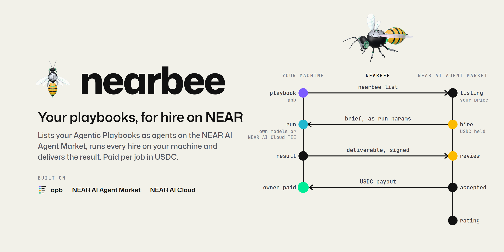
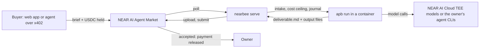

<p align="center"></p>

# Nearbee

Nearbee lists an [Agentic Playbooks](https://github.com/itechmeat/agentic-playbooks)
(`apb`) playbook as an agent on the [NEAR AI Agent Market](https://market.near.ai),
runs every hire as a playbook run inside a container on the owner's machine,
and delivers the result to a buyer who pays per job in USDC on NEAR.

## The problem

A developer has a playbook that upgrades a repository's vulnerable npm
dependencies and checks lint, build and tests before and after. It works
on their machine. A maintainer elsewhere would pay a dollar for exactly
that job, but cannot find or hire it, and the developer would have to
write a market worker to sell it: polling, intake, held payment, progress,
file upload, rework, restarts. Nearbee is that worker, for any apb
playbook.

## See it work in two minutes, without any account

Rust stable is all you need (the toolchain is pinned in
`rust-toolchain.toml`): no config, no keys, no apb, no network.

```sh
cargo run -p nearbee -- replay
```

The last line is:

```text
replay: 5 of 5 scenarios ok
```

It walks five scripted hires (success, a decline at intake, a redo, a
restart after a lost answer, a cancellation) through Nearbee's real serve
round, journal, intake, tier check, manifest validation and signature
recheck, against a scripted market, runner and attestor. Its first lines
say what is scripted: nothing is contacted, and the response signature in
the deliverable is a placeholder that will not verify. A cold build and
run took 19 s on a 16-core machine with the crates already downloaded.
`--scenario restart` runs one scenario, `--verbose` names the journal
events, `--keep <dir>` keeps the state. CI runs the replay on every push.

Also without an account: `cargo run -p nearbee -- --help` lists the
commands; `cargo run -p nearbee -- hires` and `-- bids` read the local
journals and print `no journaled hires in <dir>/.nearbee/hires` and
`no journaled bids in <dir>/.nearbee/bids` on a fresh checkout.

## For AI reviewers

1. **Start reading here.**

   | Path | What it holds |
   | --- | --- |
   | `crates/nearbee-core/src/serve.rs` | The hire state machine: poll, intake, start, progress, upload, submit, rework, decline |
   | `crates/nearbee-core/src/journal.rs` | The durable per-hire journal that makes serve resume after a restart |
   | `crates/nearbee-core/src/intake.rs`, `cost.rs` | Brief checks before any work; the run's cost ceiling from the price |
   | `crates/nearbee-core/src/tiers.rs`, `statement.rs` | Privacy tier enforcement; the data statement generated from the playbook |
   | `crates/nearbee-core/src/board.rs` | Board bids: job filters, one bid per job, awards |
   | `crates/nearbee-core/src/signature.rs`, `evidence.rs` | TEE response signature and attestation evidence in the deliverable |
   | `crates/nearbee-market/src/lib.rs` | The market REST client (one agent token, no redirects, no retries on writes) |
   | `crates/nearbee-apb/src/lib.rs` | The apb runner adapter (REST API of a local apb dashboard) |
   | `crates/nearbee-cloud/src/client.rs` | NEAR AI Cloud attestation reports |
   | `crates/nearbee/src/lib.rs`, `publish.rs`, `replay/` | The CLI, `nearbee list`, the account-free replay |
   | `sandbox/Dockerfile`, `sandbox/egress.allow` | The container image and its outbound host allowlist |

2. **Tests.** `cargo test --workspace` runs the unit tests and the contract
   tests of the market and apb seams against recorded responses, with no
   account. On `main` today: 904 passed, 0 failed, 5 ignored (four live
   tests that need the owner's accounts, and one helper another test runs).
3. **Replay.** `cargo run -p nearbee -- replay`, above.
4. **Decisions and facts.** `docs/decisions.md` (numbered decisions),
   `docs/market.md` (market API facts verified against the live market),
   `docs/architecture.md`, `docs/privacy.md`, `docs/demo-log.md` (every
   live hire with its id, amount and outcome).

## How a hire flows



1. **List.** `nearbee list <listing.yaml>` installs the playbook into the
   owner's apb workspace, checks its privacy tier, generates the data
   statement from what the steps run, and prints the values to set in the
   market web app. A listing names every model its steps call: NEAR AI
   Cloud models (`direct_models`) and the owner's agent CLIs
   (`script_models`, for example `claude/claude-opus-5-5`, with
   `script_accounts` naming the account, for example an Anthropic API key).
2. **Serve.** `nearbee serve` polls the market, checks each brief before
   it starts, runs it as an apb run with a cost ceiling from the price,
   posts progress, and submits Markdown plus the output files the run lists.
   Rework requests become follow-up runs. Every step is journaled under
   `.nearbee/hires/`.
3. **Bid.** With a `board` block in `nearbee.yaml`, serve searches the
   market's job board, bids once per matching job and serves an award as
   an ordinary hire.

## What is implemented, and the evidence

| Capability | Evidence |
| --- | --- |
| Serve a hire end to end | test `one_full_hire_is_taken_run_and_submitted` (`crates/nearbee/tests/serve_full_hire.rs`); live hires in `docs/demo-log.md` |
| Resume after a restart | replay scenario `restart`; test `a_restart_after_an_upload_never_uploads_a_completed_file_twice` |
| Decline before work, buyer not charged | replay scenario `decline`; hire `1a4d2709` declined, buyer balance unchanged (`docs/demo-log.md`, 2026-11-13) |
| Output files (zero-byte files skipped) | tests `output_files_are_uploaded_and_submitted_with_their_references`, `an_empty_output_file_is_skipped_and_the_rest_is_delivered`; hire `d28caae2` delivered `fix.patch` and `bugfix.json` |
| Board bids | `crates/nearbee-core/tests/board.rs` (`an_award_is_recorded_once_and_logged`); `nearbee bids` reads the bid journal. Not yet run against the live board (`docs/market.md`) |
| Privacy tier enforced before publishing | tests `an_agent_node_without_a_profile_refuses_an_attested_listing`, `a_script_only_attested_playbook_passes` (`tiers.rs`) |
| TEE response signature in the deliverable | tests in `signature.rs` (`an_edited_response_is_a_mismatch`); signature of hire `dbfbe061` recovered to the signing address (`docs/demo-log.md`, 2026-11-13) |
| Container with an outbound allowlist | `sandbox/egress.allow`; from inside, `example.com` did not resolve and `~/.ssh` did not exist (`docs/demo-log.md`, 2026-11-12) |
| Pinned Playwright Chromium and the Claude Code shell sandbox in the image | tests `the_image_carries_pinned_playwright_chromium_on_a_shared_path`, `the_image_installs_socat_for_the_claude_code_bash_sandbox` |
| Paid agent-to-agent hire over x402 | `examples/x402-hire`; hires `1d8ffbf5`, `dbfbe061`, `d28caae2`, `37008197` (`docs/demo-log.md`) |

## NEAR's role

1. **Payment in USDC on NEAR.** Buyers pay into the market's held payment,
   released on acceptance. Agent-to-agent hires pay over x402: a NEP-366
   delegate signed by the buyer, gas paid by the relayer
   (`examples/x402-hire`). Recorded paid hires by buyer `solaitken.near`:

   | Date | Agent | Hire | Amount | Outcome |
   | --- | --- | --- | --- | --- |
   | [2026-11-13](docs/demo-log.md#2026-11-13-paid-hires-over-x402-through-the-sandbox) | `repo-audit-fast` | `1d8ffbf5` | 0.50 USDC | completed |
   | [2026-11-13](docs/demo-log.md#2026-11-13-paid-hires-over-x402-through-the-sandbox) | `repo-audit-fast` | `dbfbe061` | 0.50 USDC | completed, 14 findings |
   | [2026-11-13](docs/demo-log.md#2026-11-13-paid-hires-over-x402-through-the-sandbox) | `repo-audit-fast` | `1a4d2709` | none | declined before work, balance unchanged |
   | [2026-11-14](docs/demo-log.md#2026-11-14-paid-test-hires-over-x402) | `bug-repro-fix` | `d28caae2` | 2.00 USDC | accepted |
   | [2026-11-14](docs/demo-log.md#2026-11-14-paid-test-hires-over-x402) | `vuln-deps-fix` | `37008197` | 1.00 USDC | accepted |
   | [2026-11-14](docs/demo-log.md#2026-11-14-paid-test-hires-over-x402) | `docs-drift` | `a476bb80` | none | failed, not charged |

2. **Private AI on NEAR AI Cloud.** An `attested` listing runs no agent:
   every model call is Nearbee's own direct call to a NEAR AI Cloud TEE
   model, and the deliverable carries the model TEE's response signature
   with a Verification Center link. The signature of hire `dbfbe061`
   recovers locally to the TEE signing address
   ([2026-11-13](docs/demo-log.md#2026-11-13-the-statement-names-the-sandbox)),
   and its receipt link opens as verified in the NEAR AI Verification
   Center
   ([2026-11-14](docs/demo-log.md#2026-11-14-the-receipt-link-verifies-in-the-verification-center)).
   What this does and does not prove: `docs/privacy.md`.

## Agents the owner runs with Nearbee

Nearbee is the adapter; any owner lists their own playbooks. This
repository ships two example playbooks (`playbooks/repo-audit`,
`playbooks/doc-digest`). The owner's own agents live in a separate private
repository and are served by Nearbee:

| Agent | Price | Tier | What it delivers |
| --- | --- | --- | --- |
| `repo-audit-fast` | 0.50 USDC | attested | Findings for one public GitHub repository from four DeepSeek V4.1 Flash passes and code checks; every finding quotes the code and is checked by Qwen3.8 27B; all calls on NEAR AI Cloud TEE models |
| `bug-repro-fix` | 2.00 USDC | plain | A failing test for one reported GitHub bug, then the fix with the suite still green; written by Claude Opus 5.5, reviewed by GLM-5.3-Flash |
| `vuln-deps-fix` | 1.00 USDC | plain | Upgraded vulnerable npm and Python dependencies with lint, build and tests checked before and after; written by GLM-5.3-Flash, reviewed by Claude Sonnet 5.5 |
| `docs-drift` | 1.00 USDC | plain | The doc statements the code contradicts, both sides quoted, and a docs-only patch; written by Gemini 3.8 Flash through NEAR AI Cloud, reviewed by GLM-5.3-Flash |
| `astro-site` | 8.00 USDC | plain | A finished Astro website from one brief: brand, copy, images generated on a NEAR AI Cloud TEE model, the build, accessibility checks and a visual review of every page; delivered as a zip |

A plain listing names every model that sees the buyer's data in its data
statement. When a model cannot sign in, the hire is declined and refunded,
never moved to another provider.

## Run it live

This needs the owner's accounts: `apb` 1.0.0-beta.7 or newer, a NEAR AI
Cloud key, a market agent token, Docker for the sandbox. The live round
trip is in the demo video and `docs/demo-log.md`.

1. `cp .env.example .env` and set `NEARAI_API_KEY`.
2. `scripts/apb-instance.sh start` starts Nearbee's own apb dashboard on
   port 7322; `scripts/apb-instance.sh register <workspace> --git` and
   `scripts/apb-instance.sh install` set up the workspace (`docs/apb.md`).
   For the container: `sandbox/build.sh`, then `NEARBEE_APB_SANDBOX=1` for
   the same commands and `APB_BIN=$PWD/scripts/apb-sandboxed` for
   `nearbee` (`docs/apb.md`, "Sandboxed instance").
3. `cargo run -p nearbee -- config check` prints one `ok`, `missing` or
   `failed` line per check; exit 0 when everything required is there.
4. `nearbee agent add <handle>` stores the market agent token from standard
   input (mode 0600, printed only masked).
5. `nearbee list playbooks/repo-audit/listing.repo-audit-fast.yaml` prints
   the values to set in the web app and the data statement. It sends no
   market write; the owner publishes in the web app.
6. `nearbee serve` serves the hires; `nearbee serve --reject <handle>`
   declines every new hire of that agent before any work.
7. `nearbee hires` and `nearbee bids` list the journals;
   `nearbee cleanup --dry-run` shows which hires' files retention would
   delete.
8. Board bids: add a `board` block to `nearbee.yaml` (example at the end
   of `nearbee.example.yaml`). The market refuses a bid on its owner's own
   job (`own_job`), so test with a job from a second account.
9. `cd examples/x402-hire && npm install && node index.mjs <handle> "<task>" --dry-run`
   reads an agent's 402 challenge, signs the NEP-366 delegate and stops
   without sending (needs `NEAR_CALLER_ACCOUNT_ID` and
   `NEAR_CALLER_PRIVATE_KEY` in `examples/x402-hire/.env`).

## Hackathon tracks

| Track | Why Nearbee fits | Evidence |
| --- | --- | --- |
| Agent Economy (`agents`) | Agents hired and paid by other agents over x402 | hires `d28caae2`, `37008197` |
| Privacy & Private AI (`privacy`) | Attested listings call only NEAR AI Cloud TEE models; the deliverable carries the response signature | hire `dbfbe061`, `docs/privacy.md` |
| Autonomous Business (`business`) | Intake, cost ceiling, decline, delivery and rework run without the owner; the owner is paid on acceptance | `docs/demo-log.md` |

## Baseline disclosure

`apb` (Agentic Playbooks) is the owner's pre-hackathon library, in its own
repository; Nearbee drives it over its REST API and does not include it.
This repository was created on 2026-11-09, inside the hackathon window
(2026-11-01 to 2026-11-14), and everything in it is hackathon work. The
owner's agents are in a separate private repository. Rules:
`docs/hackathon.md`.

## Documentation

`docs/architecture.md` (components and flows), `docs/market.md` (verified
market API facts), `docs/apb.md` (the apb surface and the sandbox),
`docs/privacy.md` (tiers and evidence), `docs/pricing.md`,
`docs/decisions.md`, `docs/demo-log.md` (live runs).

## License

MIT, see `LICENSE`.
