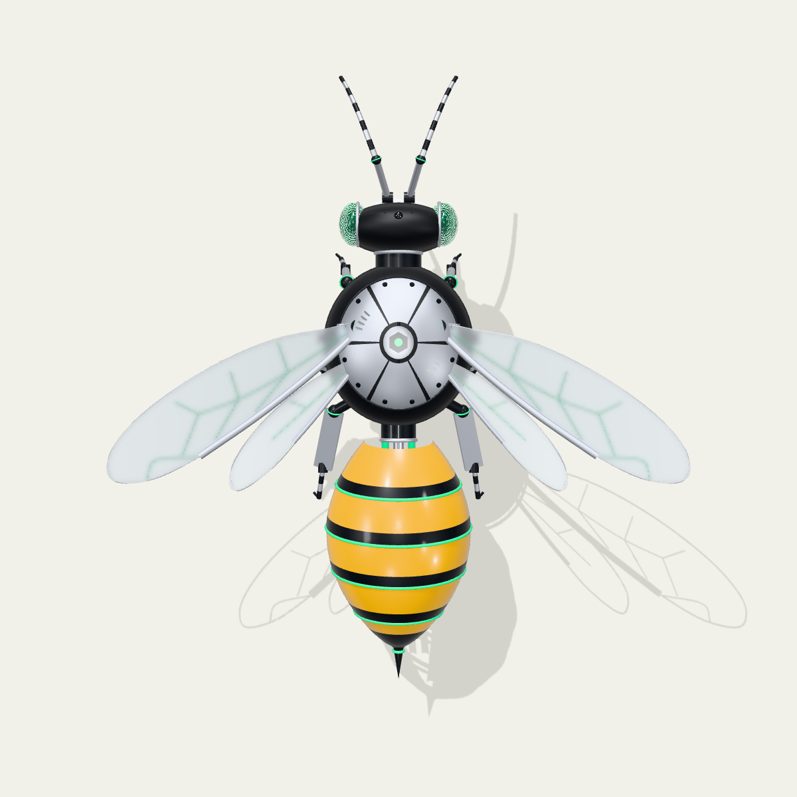

# Nearbee brand

The Nearbee mark is a high-tech mechanical honey bee. It is Nearbee's own
mark: the repository cover, the project logo and the template for the covers
of agents listed with Nearbee all start from it.



## Idea

High-tech in the architectural sense (structure and services shown on the
outside, steel and glass, colour-coded service lines), applied to the real
anatomy of an *Apis mellifera* worker. No neon, no glow: the look comes from
the parts and their materials.

## Anatomy

The model follows the bee, not a cartoon of it:

1. Head: flat, facing forward, two large oval compound eyes on the sides made
   of hexagonal lenses in aluminium bezels, three ocelli on top, mandibles.
2. Antennae: elbowed. A straight scape, a ball joint, then a segmented
   flagellum that droops forward.
3. Thorax: the largest body part and the wing carrier. A matte black housing
   with panel seams, a dorsal plate of six machined panels around a hex hub
   (screws, vent slots), and piston actuators on the flanks that drive the
   wing hinges.
4. Wings: a long forewing and a small hindwing on each side, frosted glass
   plates with an aluminium edge and NEAR-green veins.
5. Abdomen: five telescoping plates, amber with a dark rear band each, a green
   rolled edge on every plate. The underside is open and shows the ribs, the
   spine and three green service lines running in from the thorax.
6. Legs: three segmented pairs (femur, tibia, tarsus, claw) on ball joints
   with a thin green ring; the hind tibia is a flat plate.

## Palette

| Role | Colour | Source |
| --- | --- | --- |
| Ground, light | `#f2f1e9` | NEAR |
| Ground, dark | `#101114` | |
| Body | `#17181b`, matte | NEAR black |
| Accent | `#00ec97` | NEAR green |
| Veins | `#2f9e76` | muted NEAR green |
| Abdomen | `#fcbb00` | NEAR yellow |
| Metal | aluminium, satin aluminium, graphite | |

## Logo

The logo is the bee seen straight from above, rendered with an orthographic
camera on a transparent ground (`view=logo`), next to the word `nearbee` set
in Mona Sans ExtraBold.

1. `logo/nearbee-mark.png`: the mark, 1024 by 1024, transparent.
2. `logo/nearbee-mark-512.png`, `-64.png`, `-32.png`: downscaled marks. The
   mark still reads at 32 px; at 16 px it does not, so a favicon needs a flat
   version of the same silhouette.
3. `logo/nearbee-lockup-light.png`, `logo/nearbee-lockup-dark.png`: mark and
   word on both grounds, from `logo/lockup.html` (`?bg=dark` for the dark one).

## Posters

The model renders from any angle. A preset is chosen with `view`; any of
these keys overrides it:

| Key | Meaning |
| --- | --- |
| `az` | degrees around the bee: 0 from its right side, 90 from the front, -90 from behind |
| `el` | degrees above the horizon, 90 straight down, negative from below |
| `dist` | distance from the camera to the target |
| `fov` | vertical field of view in degrees |
| `tx`, `ty`, `tz` | the point the camera looks at |
| `bg` | `light`, `dark` or `none` (transparent, for compositing) |
| `shadow` | `0` drops the ground shadow |
| `w`, `h` | image size in pixels, any aspect |

Presets: `hero`, `top`, `side`, `head`, `front`, `rear`, `low`, `logo`.

```sh
brand/render.sh 1200                     # every preset on both grounds, and the mark
brand/render.sh shot poster-a 2400 1350 'az=130&el=35&dist=8&bg=none&shadow=0'
```

## Repository poster

`poster/banner.html` (1280 by 640) is the repository poster: the logo, the
tagline, the services it is built on with their marks (`poster/logos/`, see
its `NOTICE.md`) and a diagram of how Nearbee works, with the bee above the
Nearbee lane. `poster/banner.png` is taken at device scale 2 (2560 by 1280,
about 240 KB); it opens the top-level README and is also the image for the
GitHub social preview (set by hand in the repository settings). The bee in it
is `renders/poster-bee.png`, a shot cropped to the bee:

```sh
brand/render.sh shot poster-bee 900 600 'az=34&el=30&dist=10.5&tx=0.15&tz=0&bg=none&shadow=0'
# then crop renders/poster-bee.png to its opaque bounds
chromium --headless=new --hide-scrollbars --window-size=1280,640 --force-device-scale-factor=2 \
  --screenshot=brand/poster/banner.png brand/poster/banner.html
```

## Files

1. `bee/bee.html`: the model, three.js 0.170.0 loaded from cdn.jsdelivr.net.
2. `render.sh`: renders through headless Chromium (`CHROME` names the
   binary); it needs network access for the CDN.
3. `renders/`: 1200 by 1200 renders, `bee-<view>-<ground>.png`.
4. `logo/`: the mark, its small sizes, the lockups and `lockup.html`.
5. `poster/`: the repository poster, its source and the third-party marks it shows.

## Next

1. A flat mark for 16 px and the favicon, traced from the top view.
2. The agent cover template built on the repository poster.
